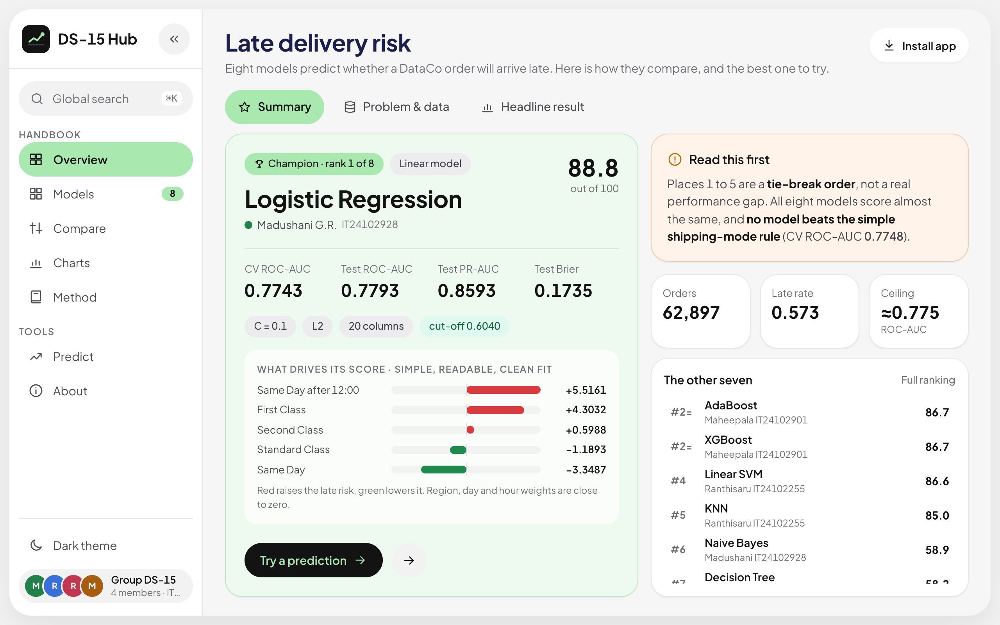
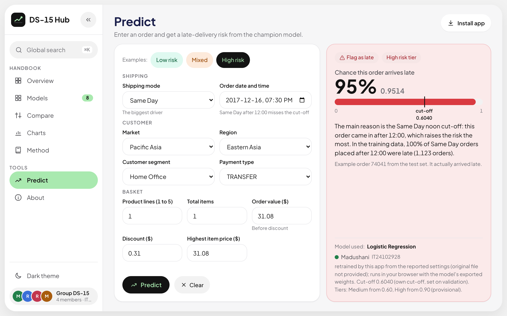
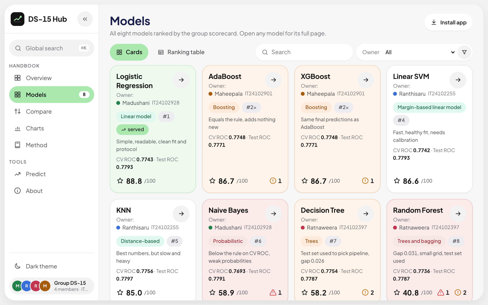
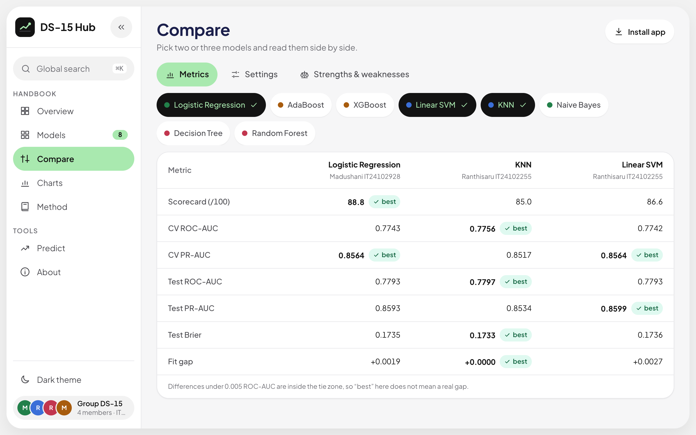
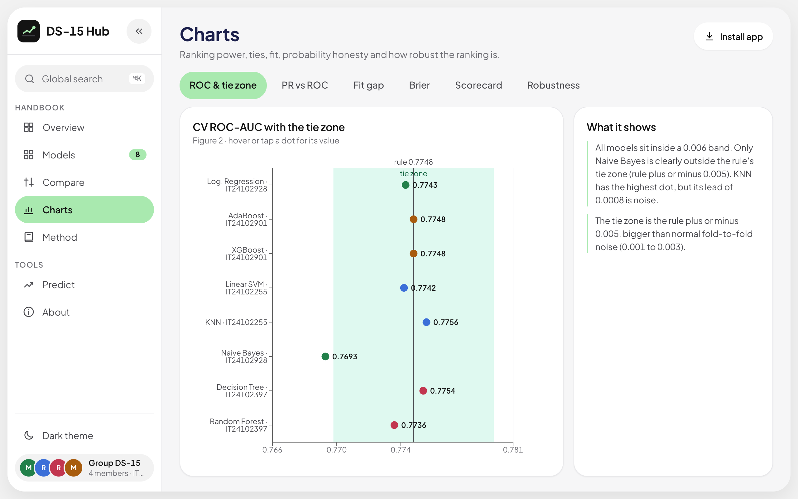
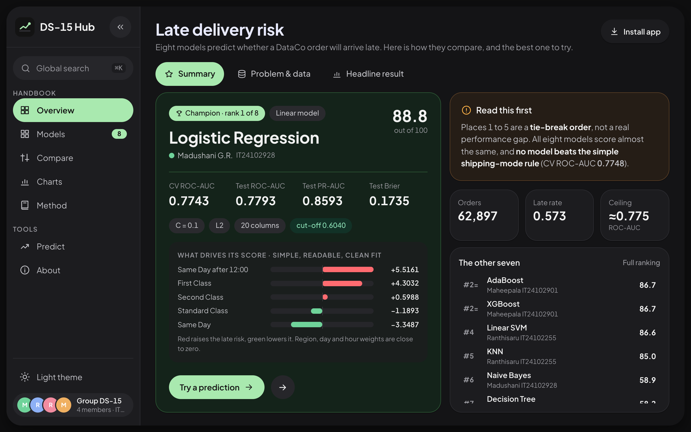
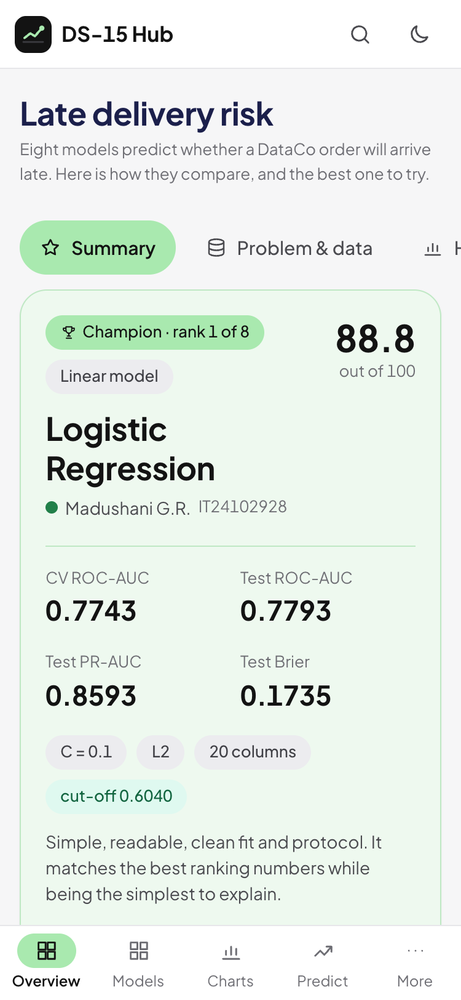
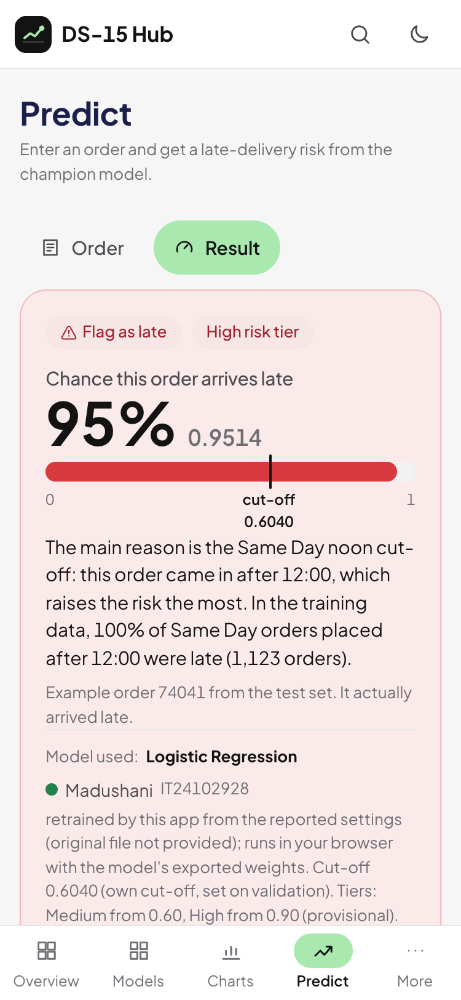
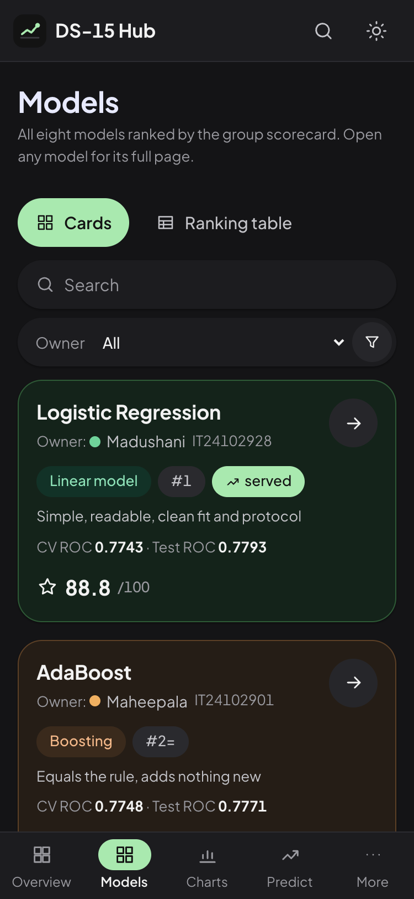

# DS-15 Hub: late delivery risk

[](https://youtu.be/Qg3hc76iwkg)

▶ **[Watch the project video](https://youtu.be/Qg3hc76iwkg)** · 🌐 **[Open the live app](https://ds15-late-delivery-hub.vercel.app/)**

A web app for IT3091 Machine Learning, Group 2026-DS-15 (DataCo Smart Supply Chain dataset). It does two jobs:

1. **Explains and compares the group's 8 models.** Every number on every page comes from one file, `content/site_data.json`.
2. **Predicts whether an order will arrive late** with the champion model: Logistic Regression by Madushani G.R. (IT24102928).

It works on phones and desktops, in light and dark themes, installs as a PWA and works offline. **The site is fully static:** the champion model runs in the browser, so no server is needed.

## Screenshots

**Overview:** the champion, its four headline metrics, what drives its score, and the other seven models.



**Predict:** fill in an order, or pick an example, and get the chance it arrives late with a plain-English reason.



| Models | Compare |
|---|---|
|  |  |
| **Charts** | **Dark theme** |
|  |  |

On a phone, the sidebar becomes bottom tabs:

<p>
  
  
  
</p>

## The pages

| Page | What it shows |
|---|---|
| **Overview** | The problem, the data (62,897 orders, late rate 0.573) and the headline result |
| **Models** | All 8 models as cards or a ranking table, each with its own page (overview, settings, notes) |
| **Compare** | Two or three models side by side: metrics, settings, strengths and weaknesses |
| **Charts** | ROC and the tie zone, PR vs ROC, fit gap, Brier, scorecard heatmap, rank robustness |
| **Method** | How the models were trained, cross-validated, scored and ranked |
| **Predict** | The champion model on any order you enter, with the reason for its answer |
| **About** | The team, known limits and how to cite the work |

Press **Cmd+K** (or Ctrl+K) on any page to search.

## Results

| Rank | Model | Owner | CV ROC-AUC | Test ROC-AUC | Scorecard |
|---|---|---|---|---|---|
| 1 | Logistic Regression | Madushani G.R. (IT24102928) | 0.7743 | 0.7793 | 88.8 |
| 2= | AdaBoost | Maheepala S.A.D.A.O. (IT24102901) | 0.7748 | 0.7771 | 86.7 |
| 2= | XGBoost | Maheepala S.A.D.A.O. (IT24102901) | 0.7748 | 0.7771 | 86.7 |
| 4 | Linear SVM | Ranthisaru T.K.K. (IT24102255) | 0.7742 | 0.7793 | 86.6 |
| 5 | KNN | Ranthisaru T.K.K. (IT24102255) | 0.7756 | 0.7797 | 85.0 |
| 6 | Naive Bayes | Madushani G.R. (IT24102928) | 0.7693 | 0.7791 | 58.9 |
| 7 | Decision Tree | Ratnaweera D.U.A. (IT24102397) | 0.7754 | 0.7787 | 58.2 |
| 8 | Random Forest | Ratnaweera D.U.A. (IT24102397) | 0.7736 | 0.7787 | 40.8 |

Places 1 to 5 are a tie-break order, not a real performance gap. No model beats the simple shipping-mode rule (CV ROC-AUC 0.7748). The full scorecard and reasons are in the app.

## Repo layout

| Folder | What it holds | Stack |
|---|---|---|
| `web/` | The web app | React 18, Vite 6, TypeScript, Tailwind 4, Recharts, vite-plugin-pwa |
| `api/` | Optional back end, pipeline rebuild and the champion retrain | FastAPI, scikit-learn 1.6.1, pandas 2.2.3 (pinned to the versions of the reported runs) |
| `content/` | `build_site_data.py`, which builds `site_data.json` from `Model_Comparison_Summary.docx` | Python |
| `sources/` | `Model_Comparison_Summary.docx` (committed) and `dataset.zip` (download it, see `sources/README.md`) | |
| `docs/` | Video script, slide and thumbnail prompts, and the README screenshots | |

## Setup (macOS)

```bash
# Python 3.13 environment, kept outside OneDrive
python3 -m venv ~/.ds15/venv
~/.ds15/venv/bin/pip install -r api/requirements-dev.txt

# Front end
cd web && npm install && cd ..
```

Put `dataset.zip` and `Model_Comparison_Summary.docx` in `sources/`, or set `DS15_SOURCES` to a folder that has them.

## Run

```bash
cd web && npm run dev                        # http://127.0.0.1:5173
# or the production build:
npm run build && npm run preview             # http://127.0.0.1:4173
```

The web app needs no back end. **Predict runs the champion in the browser:**
- `src/lib/champion-core.mjs` applies the exact linear form of the saved scikit-learn pipeline: fitted scaler means and scales, one-hot categories, 20 selected columns, coefficients and the sigmoid.
- `src/data/champion_model.json` holds those numbers, exported from the joblib file by `api/scripts/export_browser_model.py`.

The FastAPI back end is optional. It serves the same champion from the joblib file, for tests and for teammates' model files:

```bash
cd api && ~/.ds15/venv/bin/uvicorn app.main:app --host 127.0.0.1 --port 8000
```

## Rebuild the data and the champion (about 1 minute)

The repo already holds everything these steps produce, so you only need them to rebuild from scratch.

```bash
cd api
~/.ds15/venv/bin/python scripts/build_reference.py       # form values and rule-group late rates (training window)
~/.ds15/venv/bin/python scripts/build_pipeline.py        # pipeline v1.0 rebuilt from dataset.zip with Notebook 02 code
~/.ds15/venv/bin/python scripts/retrain_champion.py      # Logistic Regression, checked against IT24102928.md
~/.ds15/venv/bin/python scripts/build_parity_rows.py     # the 20 fixed test orders for the parity test
~/.ds15/venv/bin/python scripts/build_examples.py        # the Low / Mixed / High example orders
~/.ds15/venv/bin/python scripts/export_browser_model.py  # champion weights for in-browser scoring, checked exact
cd ../web && npm run data                                # site_data.json, reference and examples for the front end
```

`retrain_champion.py` prints every check. The retrained model matches all 17 reported values (CV ROC-AUC 0.7743, test ROC-AUC 0.7793, PR-AUC 0.8593, Brier 0.1735, the intercept 0.754 and the coefficients), and its 20 selected columns are the same list as in the report.

## Test

| What | Command | Current result |
|---|---|---|
| API, features, pipeline, champion parity | `cd api && ~/.ds15/venv/bin/python -m pytest -q` | 25 passed, 3 skipped (see below) |
| Parity on 20 fixed test orders | part of the run above | 20 of 20 match the saved champion predictions to 4 decimals |
| Browser model vs the Python pipeline | `cd web && node scripts/parity.mjs` | all 13,071 test orders match (max difference 5e-13) |
| Every page and tab at 375 and 1280 px, light and dark | `cd web && node scripts/screens.mjs` | 0 console errors, no sideways scroll, no page scroll on desktop |
| Rendered numbers vs the results table | `node scripts/audit-numbers.mjs` | 101 of 101 match |
| Colour contrast (WCAG AA) | `node scripts/contrast.mjs` | all pairs pass |
| Lighthouse (mobile) | `npx lighthouse http://127.0.0.1:4173/` | performance 93 to 97, accessibility 100 |

- **The 3 skipped tests** are parity tests for Naive Bayes, KNN and Linear SVM. They run once those model files are put in `api/model_store/<model>/`.
- **The screenshot and audit scripts** need the preview server (`npm run preview`). `screens.mjs` saves to `screenshots/`, which is not committed.

## API

| Endpoint | What it does |
|---|---|
| `GET /health` | Which models loaded, and why the others did not |
| `GET /models`, `GET /models/{name}` | The results table plus details. Unknown names get a 404 that lists the valid ones. |
| `POST /predict` | `{"order": {...}, "model": optional}`. Uses the champion by default. Returns the probability, the cut-off 0.6040, Late or On time, the risk tier and a plain-English reason. |
| `POST /predict/all` | Every model for one order. Models without a file come back as `available: false`. |
| `GET /reference`, `GET /examples` | Form values and the three example orders |

Inputs are checked with Pydantic: unknown fields are rejected, the region must be in the chosen market, quantity must be at least the number of lines, and the discount must be less than the order value. Values outside the training range still get a prediction, with a warning.

## Deploy (Vercel)

`vercel.json` deploys one Vercel project with two services on one domain:

| Service | Folder | Public path | What it is |
|---|---|---|---|
| `web` | `web/` | `/` | The static Vite app. Predict runs in the browser, so the site works even if the API is down. |
| `api` | `api/` | `/api/*` | FastAPI with the joblib champion |

- Neither service calls the other.
- API routes are written without `/api`. A small middleware removes the prefix, so `/api/health` (Vercel) and `/health` (local) both work.
- `api/requirements.txt` holds only the runtime dependencies, and `api/.vercelignore` leaves out the tests, scripts and the rebuilt pipeline.

To deploy, import this repo on vercel.com (**Add New → Project**), keep the root directory as the repo root and deploy. `vercel dev` runs both services locally.

**Size warning:** scikit-learn, SciPy, NumPy and pandas together are about 250 MB, close to Vercel's limit for Python functions. If the api service fails to deploy for that reason, remove the `api` service and its rewrite. The web app needs nothing from it.

## Known limits

- **The served champion is a local retrain.** Madushani's original model file was not provided. The app rebuilds pipeline v1.0 from `dataset.zip` with Notebook 02's code, then retrains Logistic Regression from her reported settings. It reproduces every reported number and coefficient exactly, but it is not her saved file.
- **Predict uses only the champion.** The other seven models are documentation only, because their saved files were not provided. Their numbers come from the group's results table.
- **The scorecard heatmap and the rank-robustness chart are images** taken from the docx, because their per-cell data was not available.
- **Risk tiers are provisional.** Medium starts at 0.60 and High at 0.90, taken from Ranthisaru's (IT24102255) notebooks.
- **The data has a ceiling of about 0.775 ROC-AUC.** Inside Standard Class and Second Class, lateness is a coin flip with respect to everything known at order time.

## Team

| Member | ID | Models |
|---|---|---|
| Madushani G.R. | IT24102928 | Logistic Regression (champion), Naive Bayes |
| Maheepala S.A.D.A.O. | IT24102901 | AdaBoost, XGBoost |
| Ranthisaru T.K.K. | IT24102255 | Linear SVM, KNN |
| Ratnaweera D.U.A. | IT24102397 | Decision Tree, Random Forest |
